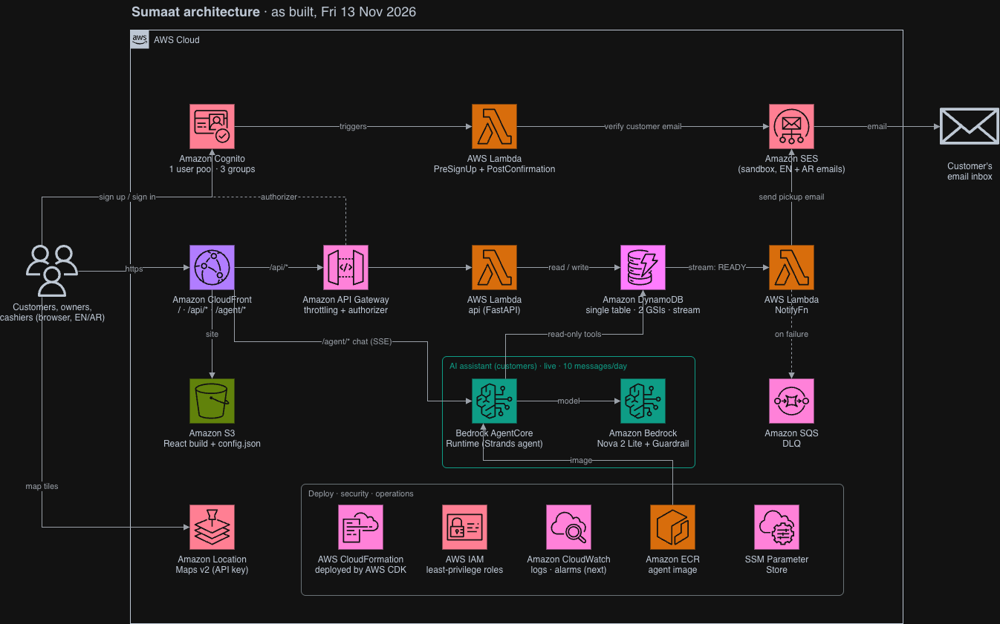

# Sumaat · سماط

Pickup-only food ordering for **Al-Ahsa, Saudi Arabia**: customers order ahead and pay at the counter.
Bilingual **English / Arabic** (full right-to-left layout). Built as a one-week proof of concept for the
AWS Builder Accelerator (11–18 Nov 2026), fully serverless on AWS and deployed with the AWS CDK (Python).

Architecture, design decisions and security: **[docs/architecture.md](docs/architecture.md)**.



## Features

| Role | What they can do |
|---|---|
| **Customer** | Browse restaurants near a map spot (1 / 3 / 4 km), filter by cuisine and diet tag, cart, place an order, track it live, get an email when it's ready. **AI assistant**: finds dishes in EN/AR and drafts a cart (10 messages a day). |
| **Owner** | Set up the restaurant (details, hours, map location, cuisines, Arabic description), edit the menu, manage cashiers, run the order board. |
| **Cashier** | Live order board: accept → ready → served, reject with a reason, pause new orders. |

Order flow: `PLACED → ACCEPTED → READY_FOR_PICKUP → SERVED` (reject/cancel only while `PLACED`). Order numbers
restart at #1 each business day (04:00 → 04:00 Riyadh). Prices include 15% VAT and always come from the database.

## Tech stack

- **Backend**: Python 3.14 · FastAPI + Mangum on AWS Lambda (arm64) · API Gateway (REST) · DynamoDB (single table)
  · Cognito · SES · SQS (DLQ)
- **AI**: Amazon Bedrock AgentCore Runtime · Strands Agents · Amazon Nova 2 Lite · Bedrock Guardrails
- **Frontend**: React 19 · Vite · TypeScript · Tailwind + DaisyUI · TanStack Query · AWS Amplify (Auth) ·
  MapLibre GL + Amazon Location Service
- **Hosting**: S3 + CloudFront (`/api/*` and `/agent/*` on the same address — no CORS in production)
- **Infra / ops**: AWS CDK (Python) + cdk-nag (AWS Solutions rules) · CloudWatch dashboard + alarms

## Repository layout

```
app.py            CDK app: 7 stacks in deploy order, cdk-nag + project=sumaat tag on everything
infra/            CDK stacks (data, auth, api, agent + guardrail, web + CloudFront functions, notify, ops)
api/              FastAPI app (routes, services, validation, Riyadh business-day logic)
agent/            AI assistant container for AgentCore (Strands agent, tools, prompt, stream filters)
functions/        Small Lambdas: Cognito PreSignUp / PostConfirmation, pickup-email notifier
web/              React app
scripts/          seed data, deploy_web.sh, smoke_test.sh, get_token.py, chat.py
tests/            pytest (+ moto) unit tests for the API, Lambdas, agent and every stack
docs/             architecture write-up + diagram (.drawio source and .png)
```

## Prerequisites

- [uv](https://docs.astral.sh/uv/) (installs Python 3.14), Node.js ≥ 22 + npm, AWS CLI v2 with credentials
- **Docker** running (bundles the API Lambda and builds the agent container image)
- An AWS account bootstrapped for CDK in `us-east-1`: `uv run cdk bootstrap`
- Bedrock model access to Amazon Nova 2 Lite in `us-east-1`
- An SES-verified sender address stored in SSM: `/sumaat/notify/sender`

## Setup and deploy

```
uv sync                                  # Python deps into .venv
cd web && npm ci && cd ..                # web deps
uv run pytest -q                         # backend tests
uv run cdk synth --quiet                 # synth + cdk-nag on all stacks
```

Deploy the stacks in order (each writes outputs to a temp file that is merged into the git-ignored
`outputs.json`; never point `--outputs-file` at `outputs.json` directly — it would drop the other stacks):

```
uv run cdk deploy SumaatData SumaatAuth SumaatApi SumaatAgent --outputs-file /tmp/out.json
jq -s '.[0] * .[1]' outputs.json /tmp/out.json > m.json && mv m.json outputs.json   # (first time: cp /tmp/out.json outputs.json)
./scripts/deploy_web.sh                  # builds web/ and deploys SumaatWeb (merges outputs itself)
uv run cdk deploy SumaatNotify SumaatOps --outputs-file /tmp/out.json   # then merge as above
```

| Stack | Contents |
|---|---|
| SumaatData | DynamoDB table (on-demand, PITR, stream), 2 GSIs |
| SumaatAuth | Cognito user pool + web client, 3 groups, PreSignUp + PostConfirmation Lambdas |
| SumaatApi | FastAPI Lambda, REST API Gateway, Cognito authorizer, throttling, access logs |
| SumaatAgent | AgentCore Runtime (container from `agent/`, JWT authorizer), Bedrock Guardrail, least-privilege role |
| SumaatWeb | S3 + CloudFront (+ 2 CloudFront Functions), Amazon Location map key, generated `config.json` |
| SumaatNotify | DynamoDB-stream email Lambda (only ACCEPTED → READY), SQS dead-letter queue |
| SumaatOps | CloudWatch dashboard "Sumaat" + 7 alarms (dashboard only, no notifications) |

Seed the demo data (15 fictional restaurants, 180 dishes, an owner + cashier per restaurant, 2 customers):

```
SEED_OWNER_PASSWORD='<password>' uv run python scripts/seed.py
```

## Run and test

```
cd web && npm run config:pull && npm run dev        # http://localhost:5173, /api proxied to the deployed API
cd web && npm test && npm run lint && npm run build # frontend tests (Vitest)
uv run pytest -q                                    # backend tests (pytest + moto)
SUMAAT_PASSWORD='<password>' VIA=cloudfront ./scripts/smoke_test.sh            # calls every live API route
SUMAAT_PASSWORD='<password>' uv run python scripts/chat.py <customer-email>     # chat with the AI in the terminal
```

Tests: ~790 backend unit tests, 178 frontend tests, and a live smoke test (112 checks).
The smoke test leaves real data behind (finished orders, a "Lamb Mandi" dish, a "Yousef" cashier) by design.

Region: `us-east-1`. Every resource is tagged `project=sumaat`.
