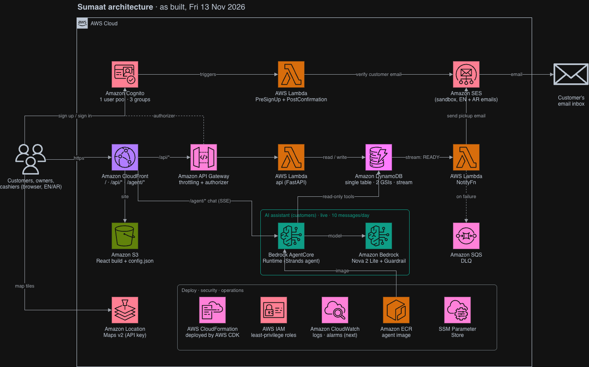

# Sumaat — architecture

*As built, Mon 16 Nov 2026.* Diagram source: [`sumaat-architecture-v4.drawio`](sumaat-architecture-v4.drawio)
(open in [diagrams.net](https://app.diagrams.net)).

## 1. Product

**Sumaat (سماط)** — the cloth spread out for a shared meal — is a pickup-only food ordering web app for
**Al-Ahsa, Saudi Arabia**, built as a one-week solo proof of concept for the AWS Builder Accelerator.

- No delivery. Customers order ahead and **pay at the counter** (cash or card). Prices include 15% VAT.
- Bilingual **English / Arabic** (full right-to-left layout), Western digits, Riyadh time.
- Three roles, **one role per account**: **customer**, **owner**, **cashier**.
- **AI assistant (customers only)**: a chat panel that finds restaurants and dishes near the customer's map spot
  (cuisine, diet tags, calories, price, open now), replies in the customer's language and can **draft** a cart.
  The customer reviews it, adds it to the cart and places the order. 10 messages per customer per day.

## 2. Request paths

| Path | Flow |
|---|---|
| **Website** | Browser → CloudFront `/*` → S3 (private, Origin Access Control). A CloudFront Function maps clean URLs to `index.html`. Runtime settings come from `/config.json`, generated by CDK at deploy. |
| **API** | Browser → CloudFront `/api/*` (a CloudFront Function strips `/api`) → API Gateway (Cognito authorizer, throttling) → FastAPI on Lambda → DynamoDB. Same address as the site, so no CORS in production. |
| **Sign-up / sign-in** | Browser → Cognito (email + password). **PreSignUp** Lambda refuses bad name/email/phone; **PostConfirmation** Lambda puts the user in their group and asks SES to verify new customers' emails (SES sandbox). |
| **Pickup email** | Order status → `READY_FOR_PICKUP` → DynamoDB Stream (filtered to that change only) → **NotifyFn** → SES email (EN + AR). Exactly once (conditional write); failures go to an SQS dead-letter queue. |
| **AI chat** | Browser → CloudFront `/agent/*` (a CloudFront Function rewrites to the runtime URL) → **Bedrock AgentCore Runtime**, which checks the Cognito access token itself → Strands agent (container image in **Amazon ECR**, built and pushed by CDK) → **Amazon Nova 2 Lite** with a **Bedrock Guardrail**. Tools read restaurants and menus from DynamoDB; replies stream back as server-sent events. |
| **Maps** | Browser → Amazon Location Service (Maps v2) with an API key restricted to the site's address. |

## 3. Business rules

- **Order flow:** `PLACED → ACCEPTED → READY_FOR_PICKUP → SERVED`. Reject (staff) or cancel (customer) only while
  `PLACED`. Forward only; every status change is a conditional write — a conflicting change gets a clear 409.
- **Order numbers** restart at **#1 every business day**; the business day runs **04:00 → 04:00 Riyadh** so
  late-night shifts keep one numbering and one "today" list.
- **One open order per customer per restaurant** (released when served, rejected or cancelled).
- **Prices always come from the database** — the client never sends prices.
- **Opening hours are automatic** (Riyadh time, incl. past midnight and 24 h); owner or cashier can pause new orders.
- **Menu items are never deleted**, only hidden (past orders keep their own copy of names and prices).
- Fixed lists: 21 menu categories (stored in the database, extendable without a deploy), 14 diet tags,
  14 cuisines (1–3 per restaurant). Restaurant descriptions in English and Arabic.
- Near-me search: 1 / 3 / 4 km (the geohash grid guarantees 4.4 km).
- **Input rules** are identical in the web forms, the API and the Cognito PreSignUp check (name, Saudi mobile
  `5XXXXXXXX` → `+9665XXXXXXXX`, email). The API trims all text input before validating.

## 4. Data model (one DynamoDB table)

- Restaurant profile, menu items, cashiers and daily order counters share the **restaurant's partition**, so one
  query loads a restaurant and its menu.
- Orders have their own items, with two indexes: a restaurant's orders by time, a customer's orders by time.
- A **geohash index** powers "near me".
- Small **lock items** enforce "one restaurant per owner" and "one open order per customer per restaurant".
- Reads right after a write use strongly consistent reads (order status replies, locks).

## 5. Infrastructure as code

AWS CDK (Python), 7 stacks deployed in order:

| Stack | Contents |
|---|---|
| **SumaatData** | DynamoDB table (on-demand, point-in-time recovery, stream on), 2 global secondary indexes |
| **SumaatAuth** | Cognito user pool + web client, 3 groups, PreSignUp + PostConfirmation Lambdas |
| **SumaatApi** | FastAPI on Lambda (Docker-bundled package), REST API Gateway, Cognito authorizer, throttling, access logs |
| **SumaatAgent** | AgentCore Runtime (container from `agent/`, image in ECR via CDK assets, JWT authorizer), Bedrock Guardrail + version, least-privilege role, 1-month logs |
| **SumaatWeb** | S3 + CloudFront (+ 2 CloudFront Functions), Amazon Location map key, generated `config.json` |
| **SumaatNotify** | DynamoDB-stream email Lambda (filtered), SQS dead-letter queue |
| **SumaatOps** | CloudWatch dashboard + 7 alarms |

**Why a container for the agent?** AgentCore can run either a container image (ECR) or a zip in S3. The
container keeps Python 3.14 like the rest of the app and packages the shared `api/` code exactly as tested;
CDK builds and pushes the image, and storage costs cents.

## 6. Security

- **Secure by default:** every API route needs a login except four public browse routes; API Gateway rejects bad
  tokens before any code runs. The API then checks the role and that staff belong to *that* restaurant (owner
  checked against the database; a disabled cashier is locked out immediately, even mid-session).
- **Least-privilege IAM** per Lambda; Cognito admin actions limited to this user pool.
- **Server-side input validation:** the PreSignUp Lambda checks every new account (website, scripts, cashiers
  created by the API); the API returns a 422 naming the field.
- **Privacy:** logs never contain emails, phones, names, tokens or passwords. The customer's email is stored only
  for the pickup email and never returned by the API. The sender address is in SSM Parameter Store, not in code.
- **AI safety:** Bedrock Guardrail (EN + AR): strict content filters, prompt-attack filter, profanity list,
  4 denied topics (medical, politics/religion, financial/legal, other food apps), phone/email masked,
  cards/IBAN blocked; every reply is checked before it is shown. The agent's IAM role can only read
  restaurant/menu/config rows and update its own chat-quota rows — never orders or customers (verified with IAM
  policy simulation). The agent only drafts a cart; it never places orders. Traces contain no message text.
- **cdk-nag (AWS Solutions rules)** runs on every stack at synth: **0 unsuppressed findings**. Each of the
  28 suppressions has a written reason; the main ones:

| Rule(s) | Decision |
|---|---|
| APIG3, CFR2 (no WAF) | WAF costs more than a one-week POC justifies; API Gateway throttling (10 req/s, burst 20) limits abuse and cost. |
| APIG4, COG4 (public routes) | Browsing restaurants/menus/categories and the health check need no login; CORS preflight can't carry a token. |
| APIG2 (request validation) | Bodies are validated in the app by Pydantic (unknown fields rejected, strict integers for money). |
| COG2, COG3, COG8 (MFA, threat protection) | POC uses the Cognito Essentials plan, email + password; revisit Plus/MFA for production. |
| CFR1, CFR3, CFR4, S1 | No geo restriction (demo audience anywhere); no CloudFront/S3 access logs (API access logs + dashboard cover the demo); default CloudFront certificate until a custom domain is added. |
| IAM4, IAM5, L1 | AWS-managed *logging-only* policies; wildcards only where AWS requires them or scoped to our own table indexes / SES identities / pool; Python 3.14 pinned project-wide; CDK-managed helper Lambdas. |
| SQS3 | The queue *is* the dead-letter queue. |

## 7. Operations and cost

- **CloudWatch dashboard "Sumaat"**: API requests / 4XX / 5XX / latency, Lambda errors and duration, sign-up
  trigger errors, pickup-email runs and dead-letter queue, AI chat messages / errors / reply time, DynamoDB
  capacity, throttles and system errors, and an alarm-status panel.
- **7 alarms** (dashboard only — they turn red, no notifications for the POC): API 5XX, API p90 latency ≥ 3 s,
  API Lambda errors, email Lambda errors, failed email in the DLQ, AI errors, AI reply p90 ≥ 20 s.
  Missing data counts as OK.
- All Lambdas and API access logs go to CloudWatch Logs, kept one month.
- **Cost guards:** pay-per-request everywhere (DynamoDB on-demand, Lambda, API Gateway, CloudFront, AgentCore),
  API throttling, map key restricted to the site, 10 AI messages per customer per day. Demo traffic costs cents.

## 8. Quality

- ~790 backend unit tests (pytest + moto) covering the API, Lambdas, agent, every CDK stack (incl. cdk-nag) and
  a demo-data quality check; 178 frontend tests (Vitest).
- A live smoke test calls every API route through CloudFront (112 checks), plus optional real AI replies.

## 9. Not in the POC (parked)

SMS notifications (Saudi sender-ID rules), estimated ready time, custom domain, WAF, SES production access,
Cognito Plus/MFA, alarm notifications (SNS), AgentCore zip deployment instead of a container.
